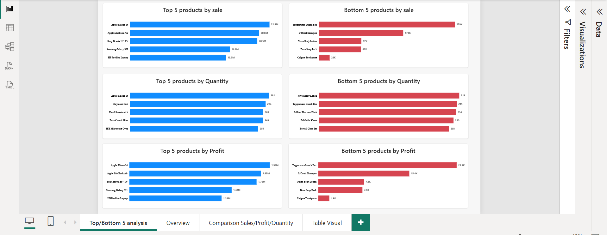
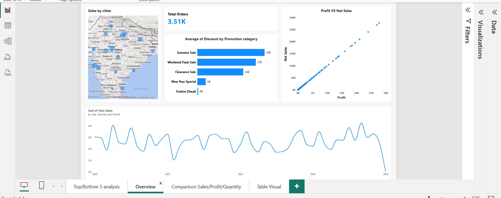
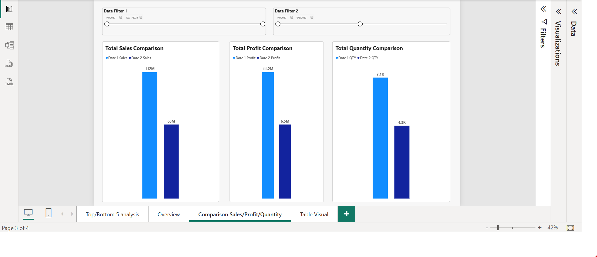
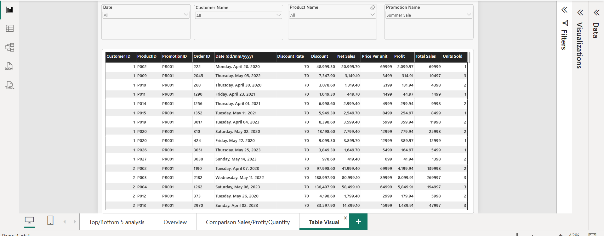

# Sales Analytics Dashboard | Power BI

An interactive Power BI dashboard built on retail store sales data. It helps a sales manager see what sells, what makes profit, and how performance changes over time.

> Built while learning Power BI through a Udemy course project, then extended and documented by me.

## Business questions answered
- Which are the top and bottom 5 products by sales, profit and quantity sold?
- How do sales trend over time (daily, monthly, quarterly, yearly)?
- What is the relationship between sales and profit?
- How do two periods chosen by the user compare?
- What is the average discount in each discount category?
- How many orders were placed in total?
- What are the order-level details, filterable by product, date, customer and promotion?
- Which cities generate the most sales?

## Tools and skills
Power BI Desktop, Power Query (data cleaning), data modelling, DAX measures, slicers, drill-down, bookmarks

## Files
| File | What it is |
|---|---|
| `Sales_analytics.pbix` | The Power BI report (open in Power BI Desktop) |
| `StoreData.xlsx` | Source data |
| `dashboard-1.png` | Dashboard screenshot |

## Dashboard preview

**1. Top/Bottom 5 products**

**2. Overview: orders, cities, discounts, sales trend**

**3. Period comparison**

**4. Order-level table with filters**

## Key findings
- **Electronics drive the revenue.** Apple iPhone 14 (22.5M), MacBook Air (20.8M), Sony Bravia 55" TV (20.5M), Galaxy S21 (16.1M) and HP Pavilion (15.5M) are the top 5 by sales, and the same 5 products are the top 5 by profit (1.28M to 1.95M).
- **Low-priced items bring in little.** Tupperware Lunch Box, L'Oreal Shampoo, Nivea Body Lotion, Dove Soap and Colgate Toothpaste are the bottom 5 by sales (22K to 279K) and by profit (1.9K to 23.5K).
- **Price matters more than volume.** Units sold are close across products (roughly 200 to 280), so the gap in sales comes from price per unit.
- **Heavy discounts sit in a few promotions.** Summer Sale has the highest average discount (26K), then Weekend Flash Sale (23K) and Clearance Sale (18K). New Year Special and Festive Diwali are almost zero.
- **Sales swing up and down every year.** Monthly sales move between about 1M and 4M with repeating peaks and dips. The sharp drop at the end of 2024 is probably an incomplete final period, so check it before drawing conclusions.
- **Period comparison:** the whole range (2020 to 2024) gives 112M sales, 11.2M profit and 7.1K units. 2020 to June 2022 alone gives 65M, 6.5M and 4.3K. So the first ~2.4 years produced about 58% of the 5-year sales.
- **Profit is about 10% of sales** in both periods, so the margin stayed steady.
- **3.51K orders** in total, spread across cities all over India.
